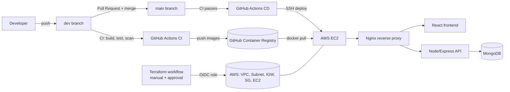

# Fullstack DevOps Automation

**An end-to-end DevOps project: a containerised full-stack app, built, scanned and deployed to AWS through automated pipelines, with the infrastructure written as code.**


## What this project shows

The application is a role-based Todo app (React frontend, Node/Express backend). It is deliberately simple, because the focus of this repo is **everything around the code**:

- A **CI pipeline** that builds, scans and publishes versioned container images.
- A **CD pipeline** that deploys to an EC2 instance only after code is merged to `main` and CI has passed.
- **Terraform** that provisions the AWS network and server from scratch, run manually behind an approval gate.
- **Keyless AWS authentication** using GitHub OIDC, with no AWS access keys stored anywhere.
- A one-click **destroy workflow** so the demo never keeps billing.

---

## Architecture



---

## Tech stack

| Area | Tools |
|---|---|
| Frontend | React, Vite |
| Backend | Node.js, Express |
| Database | MongoDB |
| Containers | Docker, Docker Compose, Nginx (reverse proxy) |
| CI/CD | GitHub Actions |
| Registry | GitHub Container Registry (GHCR) |
| Infrastructure as Code | Terraform |
| Cloud | AWS (VPC, subnet, internet gateway, route table, security group, EC2, IAM) |
| Code quality and security | SonarQube, Trivy (images, dependencies, secrets, misconfiguration) |

---

## Repository structure

```text
fullstack-devops-automation/
├── frontend/                 # React + Vite app
├── backend/                  # Node/Express API
├── nginx/                    # Reverse proxy config
├── terraform/                # AWS infrastructure as code
├── docker-compose.yml        # Local multi-container setup
└── .github/workflows/
    ├── ci.yml                # Build, test, scan, publish images
    ├── cd.yml                # Deploy to EC2 after CI passes on main
    ├── terraform.yaml        # Plan / apply infrastructure (manual)
    └── terraform-destroy.yaml# Tear everything down (manual, confirmed)
```

---

## CI pipeline

**Triggers:** push to `dev` and `main`, and pull requests into `main`.

| Job | What it does |
|---|---|
| `checkout-build-and-test` | Installs dependencies with `npm ci`, builds the frontend, builds both Docker images, scans the images with Trivy |
| `security-scan-with-sonar` | Scans the repo with Trivy (vulnerabilities, secrets, misconfigurations) and runs a SonarQube analysis |
| `push-to-ghcr` | After both jobs pass on a `dev` push, publishes images tagged with the **commit SHA** and `latest` |

Images are tagged by commit SHA so every build is traceable and can be rolled back.

---

## CD pipeline

**Trigger:** runs only when the CI workflow **completes successfully on a push to `main`**, which means a reviewed merge from `dev`. Pull request runs are ignored on purpose.

Steps:

1. Connects to the EC2 instance over SSH.
2. Logs in to GHCR and pulls the latest backend and frontend images.
3. Replaces the running containers and restarts them with `--restart unless-stopped`.

---

## Infrastructure as code (Terraform)

Terraform provisions:

- A VPC with a public subnet
- An internet gateway and route table
- A security group with restricted inbound rules
- An Ubuntu EC2 instance

The **Terraform Infrastructure** workflow is manual (`workflow_dispatch`) with a `plan` / `apply` choice:

- `fmt` and `validate` run on every execution.
- `apply` runs inside a protected GitHub Environment, so it needs an approval before it changes anything.
- After `apply`, the workflow prints the EC2 public IP in the run summary and saves it to the `EC2_HOST` repository secret, so CD always knows where to deploy.

The **Terraform Destroy** workflow requires typing `destroy` to confirm, then removes all the resources.

---

## Security practices

- **No long-lived AWS keys.** GitHub Actions assumes an IAM role through OIDC and receives temporary credentials. The role's trust policy is tied to this specific repository.
- **Least-privilege workflow tokens.** Each workflow declares only the `permissions` it needs.
- **Secrets stay in GitHub Secrets.** SSH keys, Sonar tokens and similar values are never committed.
- **Shift-left scanning.** Trivy and SonarQube run on every change, before anything is deployed.
- **Branch protection.** `main` is protected by a ruleset, so changes arrive through pull requests.
- **Approval gate** on infrastructure changes through a GitHub Environment.

---

## Run it locally

```bash
git clone https://github.com/Maheshreddy988/fullstack-devops-automation.git
cd fullstack-devops-automation
docker compose up --build
```

Open `http://localhost`. Nginx is the only service that publishes a port; the backend and database stay on internal networks.

---

## Deploy to AWS

1. **Set up AWS access** (one time): add the GitHub OIDC identity provider, create an IAM role that trusts this repository, and add its ARN as the repository variable `AWS_TERRAFORM_ROLE_ARN`. Also set `AWS_REGION`.
2. **Add secrets:** `EC2_USER`, `EC2_SSH_KEY`, and `GH_PAT` (a fine-grained token with *Secrets: read and write*, used to save `EC2_HOST`).
3. **Create the infrastructure:** Actions → *Terraform Infrastructure* → Run workflow → `plan`, review, then run again with `apply` and approve.
4. **Deploy the app:** push to `dev`, open a pull request, and merge it into `main`. CI runs, and CD deploys when it passes.
5. **Open the app** at `http://<EC2_PUBLIC_IP>`.

---

## Clean up

To avoid AWS charges: Actions → *Terraform Destroy* → Run workflow → type `destroy`. Then confirm in the AWS console that no EC2 instances or VPCs remain.

---

## Problems I solved along the way

Real issues I debugged while building this:

- **OIDC "Not authorized to perform sts:AssumeRoleWithWebIdentity".** I decoded the GitHub token's claims and found the `sub` value includes numeric owner and repository IDs, so the IAM trust policy had to match that format.
- **Terraform "No valid credential sources found" on pull requests.** Pull request runs had no AWS login. I moved infrastructure runs to manual-only so credentials are always present.
- **EC2 had no internet access.** SSH worked, but package installs timed out. The cause was a Terraform security group with no egress rule, which removes AWS's default outbound access.
- **CD never triggered.** The CI workflow was not set to run on `main`, so the CD trigger had nothing to follow.

---

## Possible next steps

- Replace SSH deploys with AWS Systems Manager (no open port 22, no private key).
- Deploy to Kubernetes with Helm and add Prometheus and Grafana monitoring.
- Add deployment health checks and automatic rollback to the previous image tag.

---

## Author

**Maheswara Reddy**, DevOps Engineer, Bengaluru, India

- GitHub: [@Maheshreddy988](https://github.com/Maheshreddy988)
- LinkedIn: _add your profile link_
- Email: _add your email_
